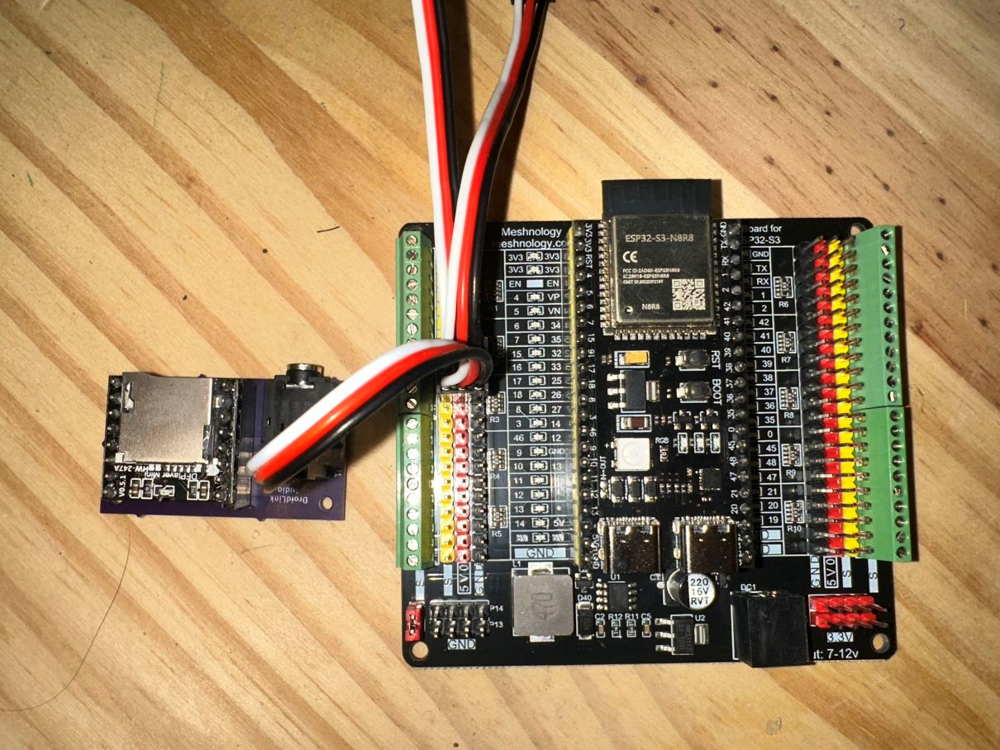

# DroidLink Documentation

**Documentation home revision 3 — Reviewed October 14, 2026**

Welcome to the public user documentation for DroidLink.

These guides explain how to install, configure, operate, update, and troubleshoot a DroidLink system. No programming experience is required.

New to DroidLink? Begin with [Start Here with DroidLink](DroidLink_Start_Here.md)
for the complete hardware, license, installation, and setup path.

- A license is required to download firmware with the DroidLink Web Installer.
- Current license pricing and purchase instructions are in [Start Here with DroidLink](DroidLink_Start_Here.md).
- Contact: droidlink77@gmail.com

## Safety and liability notice

DroidLink is a DIY hobby robotics control system. It is not intended for commercial, industrial, or safety-critical applications.

Robots can move unexpectedly and may cause injury or property damage. By building, installing, or operating DroidLink firmware or hardware, the user accepts responsibility for safe construction, testing, maintenance, and operation. Software, electronics, radio systems, wiring, and mechanical hardware can fail unexpectedly. DroidLink is provided as-is without warranty.

### Recommended safety practices

- Install an accessible physical master power switch.
- Test drive motors with the wheels raised.
- Test servos and mechanisms without linkages attached first.
- Verify RC failsafe, drive stop, and dome stop behavior before operation.
- Keep batteries and emergency power controls accessible.
- Use correctly sized, fused power supplies and common grounds.
- Never operate a droid near people, pets, or fragile property until testing is complete.
- Always supervise the droid while it is powered.

## Start here

New users should begin with [Start Here with DroidLink](DroidLink_Start_Here.md). It is the single roadmap from hardware selection through installation, pairing, safe testing, and backups.

## Complete documentation library

Use the [DroidLink Documentation Index](DroidLink_Documentation_Index.md) to find every maintained online guide, downloadable PDF, command reference, template, and firmware feature guide.

The index is organized by:

- New firmware features
- Master Controller
- Watch Display
- DroidLink Slave
- DroidLink_AP
- Dedicated accessories
- Downloads and revision records

### Links to share

For a new installation, share:

<https://github.com/DroidLink/DroidLink_Docs/blob/main/DroidLink_Start_Here.md>

For the complete guide library or the new firmware feature guides, share:

<https://github.com/DroidLink/DroidLink_Docs/blob/main/DroidLink_Documentation_Index.md>

The [PDF Revision History](downloads/guides/PDF_Revision_History.md) identifies the revision and SHA-256 checksum of every maintained downloadable PDF.

## Document revisions and firmware releases

Every maintained Markdown guide shows its document revision and review date
near the title. Downloadable PDFs show the same revision in the document and
are recorded with a SHA-256 checksum in the PDF revision history.

Document revisions are separate from firmware versions. The
[Firmware Changelog](reference/Firmware_Changelog.md) is the single source for
current, testing, legacy, and historical firmware versions. A firmware feature
is documented as released only after that firmware is available to users
through the DroidLink Installer and Gatekeeper.

## Optional audio hardware

A DFPlayer Mini breakout board designed for DroidLink is available to simplify audio wiring and reduce connection errors.

Current breakout-board pricing and availability are listed in [DroidLink Main Hardware](reference/Parts_List.md).

## Documentation scope

These documents are intended for end users. They cover installation, wiring, setup, commands, normal operation, supported updates, and troubleshooting.

They intentionally do not publish firmware source code, private service details, security controls, credentials, or internal communication implementation.

## Licensing

This documentation is licensed under the MIT License. DroidLink firmware and product usage are licensed separately.
